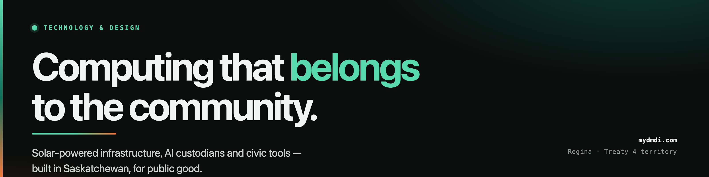

  

  
  
  

### Research and engineering for public good

myDMDi Technology & Design Corp. is a Canadian research and engineering firm working from Regina,
Saskatchewan — Treaty 4 territory. We build computing a community can own: infrastructure that runs on
sunlight where the grid is thin, AI that answers only to the person who operates it, and civic tools
that stay in the hands of the people who use them.

The code lives in the [**DMDi** organisation](https://github.com/DMDi). This profile is the front door.

---

## What we are working on

| Project | What it is |
|---|---|
| **Solar Autonomous Computing** | Edge computing that runs on its own panel — designed for places where power and bandwidth are scarce, not assumed. |
| **AIM — AI custodians** | Blueprints for AI systems that run a person's whole stack and answer to nobody else. The licence key can attest that a system is paid for; it can never issue it a command. |
| **Augmented civic services** | Community access hubs that put public services within walking distance, on local hardware. |
| **Post-quantum security** | Moving civic and research infrastructure onto cryptography that survives the next decade. |
| **IoT and remote sensing** | Low-power environmental sensing, deployed at the scale of a watershed rather than a lab. |
| **360 / VR storytelling** | Immersive documentation — for knowledge that a flat page loses. |
| **Code and Coffee** | Free, recurring, in-person technical mentorship. Vancouver and Regina. No slides, no pitch. |

We work in the open where we can and privately where the data belongs to someone else.

---

## Work with us

### University researchers — Canada

We have testbeds that are hard to build inside a lab: solar-powered compute nodes in the field, local
model clusters, and long-standing relationships with the communities those systems sit in. We are
looking for research partners in distributed systems, energy-aware computing, applied cryptography,
and community-based data governance.

**What we bring:** hardware, deployment, community access, engineering time.
**What we ask:** rigour, a shared question, and honesty about what the results mean.
Write to us with a paragraph about the problem — not a proposal template.

### Volunteers

Code and Coffee runs on people who show up. We also need help with documentation, French translation,
accessibility testing, and trying our tools on real, slow, old hardware — which is the hardware most
people actually have.

**A few hours a month, reliably, beats a heroic weekend.** Start by coming to a session.

### Collaborators and partners

Non-profits, municipalities, libraries, and Indigenous communities: we build *with* you, not *for*
you. That means the system is yours at the end — root key included — and our access ends at handover.
We are especially interested in projects where data sovereignty is a requirement, not an afterthought.

---

## How we work

- **Ownership stays with the operator.** If we hand you a system, you hold the key and we cannot
  re-enter it. This is a design constraint, not a policy.
- **Solar-first, open-source-first.** The cheapest, lowest-emission option that works.
- **Boring where it counts.** No default credentials, no shared admin accounts, no "temporary" access
  that survives the project.
- **Privacy by structure.** OCAP-aligned data governance: data about a community is held by that
  community.

---

  
    <strong>English &amp; Français</strong> — écrivez-nous en français, nous répondrons en français. 
    Regina, Saskatchewan · Treaty 4 territory · <a href="https://mydmdi.com">mydmdi.com</a>
  

